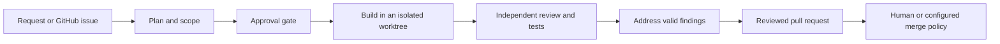
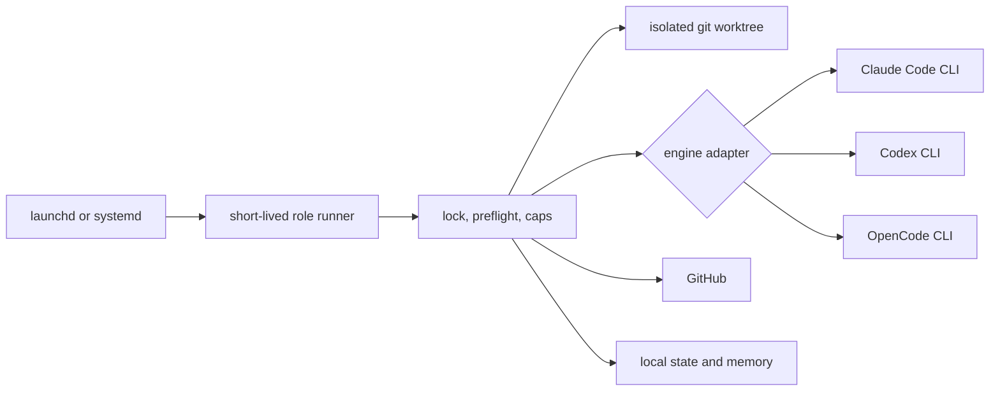

# Alfred

<p align="center">
  
</p>

[](https://github.com/luminik-io/alfred/actions/workflows/ci.yml)
[](LICENSE)

Alfred runs Claude Code, Codex or OpenCode on a schedule against your GitHub
repositories and turns well-scoped issues into reviewed pull requests.

Each role (planner, developer, reviewer, test engineer, fixer) is a short-lived
process started by the operating system's scheduler: `launchd` on macOS,
`systemd --user` on Linux. Code changes happen in isolated git worktrees.
Every run checks locks, auth and daily caps before it calls a model, and stops
on repeated failure. A person approves gated plans and decides what merges.

Alfred uses the coding CLIs and subscriptions you already have. There is no
model gateway, hosted service or long-running coordinator to operate.
It runs on macOS 11 or newer and on Debian or Ubuntu Linux, with Python 3.11
or newer.

## Status

Alfred is archived and no longer maintained. It was built between April and
September 2026 to run coding agents unattended on one machine. Since then, the
coding tools have added most of what it did: scheduled and background agents, a
git worktree per run, and pull requests opened for review.

For the same job today, look at:

- [Claude Code scheduled tasks](https://code.claude.com/docs/en/routines) and
  [background agents](https://code.claude.com/docs/en/agent-view)
- [GitHub Agentic Workflows](https://github.github.com/gh-aw/), which also caps
  spend per run and per day
- [OpenHands](https://github.com/OpenHands/OpenHands) automations
- [OpenAI Symphony](https://github.com/openai/symphony), which runs one agent per
  ticket and merges on acceptance

The parts most worth reading:

- [`lib/merge_gate.py`](lib/merge_gate.py): the merge decision, which refuses
  whenever any input is missing or unclear
- [`lib/agent_runner/state.py`](lib/agent_runner/state.py): locks, the daily
  spend ledger behind the per-role caps, and the pause after 5 failures in a
  row
- [`lib/agent_runner/engine_registry.py`](lib/agent_runner/engine_registry.py):
  checks each CLI's flags and login before any work starts
- [`lib/labels.py`](lib/labels.py): the issue label state machine, including
  the `agent:plan-pending-approval` label that holds work until a person
  approves it

Known issues at the time of archiving:

- When the developer, reviewer or fixer role reaches its daily turn cap, it
  calls `launchctl` directly. On macOS that unloads the job until you run
  `alfred resume`. On Linux nothing is unloaded and the cap message repeats on
  every firing.
- The latest packaged release is v0.6.0. Version 0.8.0 on `main` was never
  packaged.

The rest of this README describes Alfred as it stood when it was archived.

## Who it is for

Alfred fits one developer or a small team that already uses a coding CLI
interactively and has a backlog of work that is clear enough to hand off:

- bug fixes and small features written up as GitHub issues
- review comments that need a follow-up commit
- missing tests on code that changes often
- dependency bumps
- a change that has to land across several repositories in order

Alfred works through that backlog on a schedule, on one machine you control.
Model usage comes out of the plans you already pay for.

It is a poor fit if you need a multi-tenant service, a sandbox for untrusted
code, or agents that merge without any human review. See [limits](#limits).

## How work moves



GitHub is the coordination layer. Issues, labels, branches, review comments and
pull requests carry the state between roles, so you can follow and correct the
work with the tools your team already uses. Slack and a local desktop app are
optional views on the same state.

## Try it in 5 minutes

The demo runs the whole loop once on a throwaway copy of a small Python
project. It needs Python 3.11 or newer and one signed-in coding CLI. It does
not need GitHub, Slack or an API key, and it does not install a scheduler job.

```sh
git clone https://github.com/luminik-io/alfred.git
cd alfred
python3 ./bin/alfred demo
```

The default route tries Claude Code first and falls back to Codex. Pass
`--engine codex` or `--engine opencode` to pick one. Pass `--yes` to skip the
approval prompt.

One run does 5 things:

1. A planner drafts a plan to add a missing `slugify` helper.
2. The run pauses at an approval gate until you press Enter.
3. A developer role implements the plan in a git worktree.
4. A separate reviewer checks the diff. The sample project has a planted bug
   in an existing function, and the reviewer is asked to reproduce any bug it
   reports.
5. If review blocks, the developer fixes it and adds a regression test. The
   demo then runs the test suite and commits locally only if the tests pass.

On an Apple silicon Mac using Codex, one full run took 110 seconds and the
reviewer caught the planted bug. A model can miss it on a given run. See the
[demo guide](docs/DEMO.md) for details.

If you prefer a script that checks prerequisites before cloning, `get.sh` does
the same clone and prints the exact demo command for your machine:

```sh
curl -fsSL https://raw.githubusercontent.com/luminik-io/alfred/main/get.sh | sh
```

## Point it at your repositories

Install the runtime, sign in, then choose repositories and roles:

```sh
bash install.sh               # packages, Python env, ~/.alfred, Claude Code if missing
gh auth login
claude auth login
codex login                   # optional, for roles routed to Codex
./bin/alfred-init.py          # repos, roles, schedules, approval rules, then deploy
```

`alfred-init` needs Claude Code installed and signed in, even when some roles
run on Codex or OpenCode. It ends by running `deploy.sh`, which loads the
chosen roles into the scheduler, so they can start firing right away. To check
each role before it runs on its own, pause everything and resume one role at a
time:

```sh
./bin/alfred pause all
./bin/alfred auth status      # which engines are ready
./bin/alfred doctor           # host preflight checks
./bin/alfred dry-run senior-dev
./bin/alfred resume senior-dev
```

A dry run resolves the role and walks its lifecycle without calling a model or
touching GitHub, Slack, git or the scheduler.

Start with `--agents starter` on one repository. It enables the planner,
developer and reviewer plus cleanup and memory upkeep.
Add roles once you trust the output. The [installation guide](INSTALL.md) covers
every step, unattended setup, and the [Linux](docs/LINUX.md) differences.

## Budgets, approvals and merge control

Each control below is an environment setting in `~/.alfred/.env`. The
[configuration reference](docs/CONFIG.md) lists them all.

### Budgets

Caps count turns and actions per role per day:

| Control | Default | Effect |
|---|---|---|
| Daily turn cap per role | developer 5000, reviewer 800, fixer 600, triage 600 | Triage skips the rest of the day. On macOS the developer, reviewer and fixer unload their scheduler job and stay stopped until you run `alfred resume` |
| Daily action cap per role | reviewer 30 reviews, triage 50 actions | Same |
| Per-firing timeout and max turns | per role, for example 900 s per review | The run stops and is recorded as failed |
| Failure streak | 5 consecutive failures | The role pauses itself until you run `alfred resume` |
| Provider budget error | always on | The run stops. Rate limits and overloads retry with a bounded wait |

Each role writes a per-day spend ledger with firings, turns, successes,
failures and dollar cost when the engine reports one. `alfred usage` shows
remaining Claude Code and Codex subscription headroom from local CLI state, and
`alfred metrics` gives a weekly roll-up. Alfred records dollar cost and does
not enforce a dollar cap.

### Approval gate

Any issue labelled `agent:plan-pending-approval` stays out of the queue until
the configured approver approves it and the label is cleared. Developer roles
skip it on every firing until then. See the
[issue state machine](docs/STATE_MACHINE.md).

The architect role, which splits one change across several repositories, has
its own gate. By default it posts the rollout plan and stops. With
`ARCHITECT_AUTO_EXECUTE=approval-gate` it waits for approval in Slack or the
desktop app before it files child issues. See [multi-repo changes](docs/ARCHITECT.md).

### Review

Reviews run in a separate process and worktree from the code they review. The
reviewer posts findings on the pull request. The fixer addresses high-priority
findings from the reviewer and from external reviewers such as Codex or
CodeRabbit. Agent pull requests include a verification section that lists
what ran, what passed and what was skipped. See
[verification](docs/VERIFICATION.md).

### Merge

Alfred merges a pull request only when the `automerge` role is enabled.
`alfred-init --agents all` enables it, so leave it out of `--agents` if you
want to merge every pull request by hand. The role only touches
`agent:authored` pull requests, and merges one only when all of these hold:

- at least 1 approval on the exact head commit (`ALFRED_MERGE_MIN_APPROVALS`;
  setting `ALFRED_MERGE_REQUIRE_APPROVAL=false` drops this requirement)
- zero unresolved review threads
- GitHub reports the merge state as clean
- no failing checks
- the base branch requires resolved threads, so GitHub enforces this too

Any API error or unrecognized value counts as "not mergeable". See the
[merge gate](docs/MERGE_GATE.md).

## Memory and context

Lessons from past runs (a failing command, a repository convention, a review
finding that recurred) are stored locally and recalled into later prompts.

- The default store is embedded SQLite with full-text search. It needs no
  extra service.
- Redis, and Postgres with pgvector, are optional backends for larger
  installs. See [memory providers](docs/MEMORY_PROVIDERS.md).
- A new lesson passes structural checks and a confidence review before it can
  affect a run. `alfred brain` lists, promotes, rejects and forgets lessons.
  See [fleet brain](docs/FLEET_BRAIN.md).
- Two read-only MCP servers give roles scoped access to fleet memory and a
  code graph. See [MCP](docs/MCP.md).
- Prompt-size controls compact successful tool output, read large files by
  structure first and trim recalled lessons to a budget. See
  [batteries](docs/BATTERIES.md).

## Day-to-day operation

```sh
alfred status                 # what ran, what is paused, what failed
alfred agents                 # roles, schedules, enabled state
alfred pause senior-dev       # stop scheduled firings
alfred resume senior-dev
alfred run reviewer           # fire one role now
alfred logs senior-dev        # transcripts for recent runs
alfred serve                  # local read-only dashboard and JSON API
```

The optional [desktop app](docs/DESKTOP_CLIENT.md) reads the same local API.
[Operating the fleet](docs/OPERATING_THE_FLEET.md) covers recovery from stuck
locks, failed runs and auth problems.

## Limits

- **No sandbox.** Roles run with your user account's permissions, including
  network access. Repository scope limits what Alfred schedules. An agent can
  still reach anything your account can. Use a dedicated OS user, VM or
  container when you need a harder boundary. Read the
  [threat model](docs/THREAT_MODEL.md).
- **One host.** One trusted machine and one config. There is no multi-host
  scheduling or multi-tenant mode.
- **GitHub only.** Issues, labels and pull requests are the work queue.
- **Results depend on the issue.** A loosely written issue tends to come back
  as a loosely scoped pull request. The planner tightens scope, and the
  [spec-driven workflow](docs/SPECS_DRIVEN_DEVELOPMENT.md) gives agents more
  structure.
- **No telemetry.** The anonymous proof-telemetry reporter and its hosted
  collector were removed. Alfred sends no usage data. Older installs can delete
  the `alfred.proof-telemetry` row from `agents.conf` and redeploy.
- **Claude auth repair.** When a scheduled Claude Code call fails auth, Alfred
  moves a stale `~/.claude/.credentials.json` aside once and retries so the CLI
  can use the macOS Keychain. Set `ALFRED_DISABLE_CLAUDE_AUTH_REPAIR=1` to turn
  this off.
- **Packages lag `main`.** The latest published release is
  [v0.6.0](https://github.com/luminik-io/alfred/releases), which is what the
  Homebrew formula and cask install. Version 0.8.0 is on `main` and is waiting
  on signed desktop packages. Use the source checkout above to run what this
  README describes.

## Architecture



The scheduler starts a fresh process for each firing. The shared runner in
`lib/agent_runner/` takes the lock, runs preflight checks, creates or recovers a
worktree, calls the chosen CLI, records events and updates GitHub. Nothing stays
running between firings. See [ARCHITECTURE.md](ARCHITECTURE.md).

## Documentation

- [Install](INSTALL.md), [onboarding](docs/ONBOARDING.md) and [Linux](docs/LINUX.md)
- [Roles and schedules](docs/AGENTS.md) and [identity and themes](docs/IDENTITY_AND_THEMES.md)
- [Coding engines](docs/ENGINE_ROUTING.md), [Claude Code](docs/CLAUDE_CODE.md),
  [Codex](docs/CODEX_PROVIDER.md) and [OpenCode](docs/OPENCODE.md)
- [Multi-repo changes](docs/ARCHITECT.md) and
  [spec-driven development](docs/SPECS_DRIVEN_DEVELOPMENT.md)
- [Memory](docs/MEMORY_PROVIDERS.md), [MCP](docs/MCP.md) and [benchmarks](docs/BENCHMARKS.md)
- [Security](SECURITY.md), [contributing](CONTRIBUTING.md),
  [roadmap](ROADMAP.md) and [changelog](CHANGELOG.md)

Rendered docs: [alfred.luminik.io](https://alfred.luminik.io/).

## License

Code is licensed under the [MIT License](LICENSE). Documentation and website
content are licensed under [CC BY 4.0](LICENSE-docs).

Copyright (c) 2026 DataRavel Inc. (dba Luminik). "Alfred" and "Luminik" are
trademarks of DataRavel Inc. See [TRADEMARK.md](TRADEMARK.md).
